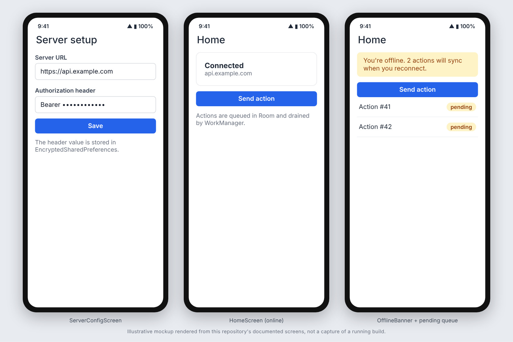

# Android Compose starter

A Jetpack Compose app skeleton: Retrofit + kotlinx.serialization networking, Room, DataStore plus
Keystore-encrypted prefs, a WorkManager offline-queue drain, connectivity awareness, and a hand-rolled
composition root. No domain code.

## Screenshots



_These images are illustrative mockups rendered from this repository's documented screens and API shapes, not captures of a running build. Regenerate or replace them with real captures once the app is running._

## What is included

- `StarterApplication`: composition root (no DI framework). `MainActivity` hosts `StarterNavHost`.
- `data/ServerConfigStore`: user-supplied server URL plus one static auth header (the header value is kept
  in `EncryptedSharedPreferences`). Replace with a build-time base URL and a token store if your backend has
  a real login flow.
- `di/ApiClientFactory`: builds a Retrofit client from the current server config (BASIC logging only; do not
  raise it to HEADERS/BODY, it would log the auth header). `data/remote/StarterApi` is the endpoint interface.
- `data/repository/ActionRepository`: submit, offline-queue and replay pattern with a permanent-versus-transient
  HTTP error split (401/403/422 are never retried) and an attempt cap. Copy it per write operation.
- `sync/SyncQueueWorker`: WorkManager drain of the queue when the network is available.
- `connectivity/ConnectivityObserver` and the `ConnectivityBanner` composable.
- `ui/components/`: shared composables next to the banner: `LoadingIndicator`, `ErrorState` (optional Retry),
  `EmptyState` (optional action), `PrimaryButton` (`loading` shows a spinner and blocks clicks) and
  `AppTextField` (optional placeholder and field error). The server-config and home screens use
  `AppTextField`, `PrimaryButton` and `EmptyState`; `ui/theme/` holds the light/dark Material 3 theme.
- `data/local`: Room database skeleton with one entity and DAO.
- `ui/`: theme, server-config screen/ViewModel, a placeholder home screen/ViewModel.
- Tests: fakes for the DAO, API and connectivity; repository unit tests; `MockWebServer` tests through the real
  Retrofit client; instrumented Compose tests for the banner and the shared components (`SharedComponentsTest`), and a JVM test for the button state rule.
- Build setup: Gradle 9.8 wrapper, AGP 9.4 built-in Kotlin, KSP, ktlint (Android Studio style), dependency
  locking (`app/gradle.lockfile`), `.editorconfig`.
- `.github/workflows`: `android-ci.yml` (ktlint, unit tests, assembleDebug, emulator tests), `security.yml`
  (gitleaks, CodeQL for Kotlin and for Actions, osv-scanner on the lockfile), `dependabot.yml`, `CODEOWNERS`.

## Use the template

```bash
./rename.sh com.acme.myapp "My App" my-github-owner
# fill in LICENSE, then:
./gradlew ktlintCheck testDebugUnitTest assembleDebug
```

You need JDK 17 and the Android SDK (compileSdk 37). After changing dependencies, regenerate the lockfile with
`./gradlew :app:dependencies --write-locks`.

## Known issue: osv-scanner exemptions are empty

`osv-scanner.toml` ships with no exemptions. At the time this template was created the committed lockfile
contained advisories in build-tooling-only packages (ktlint's `logback-core`, and AGP's Android Lint tool
classpath: `commons-lang3`, `httpclient`, `bcpkix-jdk18on`, `bcprov-jdk18on`). The `security.yml` dependency scan may fail
until those tools are bumped or you add dated `[[PackageOverrides]]` entries after confirming the packages
are absent from the shipped APK.

## Not verified

This template was assembled in a sandbox with no Android SDK, so the Gradle build, ktlint, unit tests and
instrumented tests have not been run on it. The first CI run is the verification.
